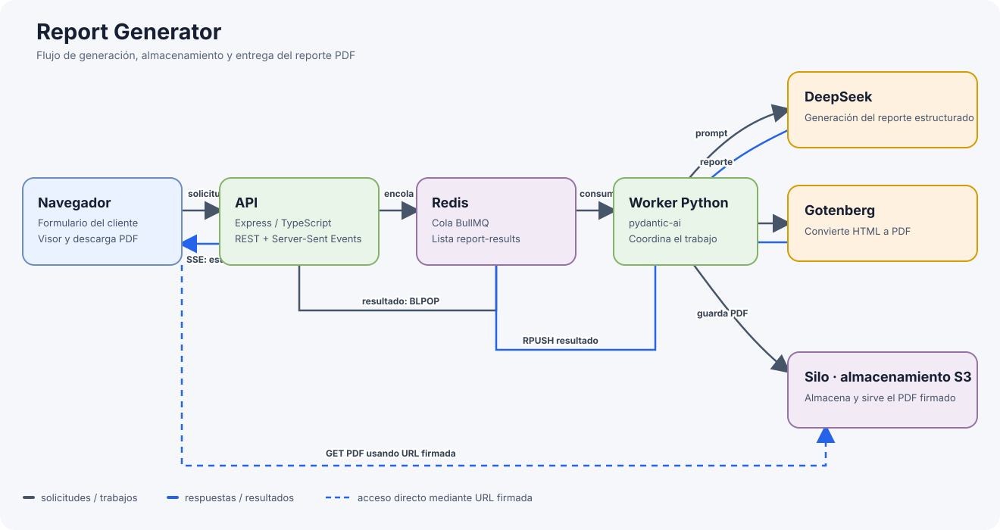

# Report Generator

Aplicación para solicitar un reporte sobre un tema, generarlo con IA y recibirlo como PDF en el navegador. El objetivo del proyecto es diseñar e implementar una arquitectura asíncrona que permita procesar la generación de reportes sin mantener bloqueada la solicitud HTTP inicial.

## Resultados

- Se implementó el procesamiento asíncrono con una cola BullMQ respaldada por Redis: la API acepta la solicitud y el worker genera el reporte en segundo plano.
- El navegador recibe el estado y el resultado mediante Server-Sent Events (SSE), mientras el worker continúa procesando independientemente de la conexión inicial.
- Se integraron DeepSeek para generar contenido, Gotenberg para convertirlo a PDF y Silo para almacenar los archivos.
- El cliente permite visualizar el PDF cuando termina y abrirlo o descargarlo mediante una URL firmada.
- Se verificó el flujo de generación de extremo a extremo: el worker produjo un PDF válido, Gotenberg respondió correctamente y el archivo quedó disponible en Silo.

## Arquitectura



El navegador carga el cliente web que sirve la API Express. Al solicitar un reporte, el cliente primero abre una conexión SSE para recibir el resultado y luego envía el tema junto con un identificador de tarea. La API agrega el trabajo a la cola BullMQ, almacenada en Redis.

El worker Python consume el trabajo y pide a DeepSeek un reporte estructurado. Después convierte el reporte a HTML y lo envía a Gotenberg, que devuelve el PDF. El worker guarda el archivo en Silo, el almacenamiento compatible con S3, y coloca el estado y la URL firmada en una lista de resultados de Redis.

La API escucha esa lista, relaciona el resultado con la conexión SSE de la tarea y notifica al navegador. Con la URL firmada, el navegador obtiene el PDF directamente desde Silo y lo muestra en el visor integrado, con una opción para abrirlo o descargarlo.

Docker Compose conecta estos servicios en una red local y configura sus dependencias y comprobaciones de salud para el arranque.

## Servicios

- **Cliente web:** formulario de tema, seguimiento del estado por SSE y visor de PDF.
- **API (Express / TypeScript):** sirve el cliente, recibe solicitudes, administra las conexiones SSE y encola trabajos.
- **Redis:** respalda la cola BullMQ y transporta los resultados del worker a la API.
- **Worker (Python):** coordina la generación del reporte, la conversión a PDF y el almacenamiento.
- **DeepSeek:** genera el contenido del reporte según el tema solicitado.
- **Gotenberg:** convierte el HTML del reporte en un archivo PDF.
- **Silo:** almacena los PDF y permite acceder a ellos mediante URL firmadas.

## Ejecución local

1. Configura `MINIO_PASSWORD` y `DEEPSEEK_API_KEY` en `.env`.
2. Desde la raíz del proyecto, inicia los servicios:

   ```powershell
   docker compose up -d --build
   ```

3. Abre <http://localhost:3000>, escribe un tema y selecciona **Generar reporte**.
